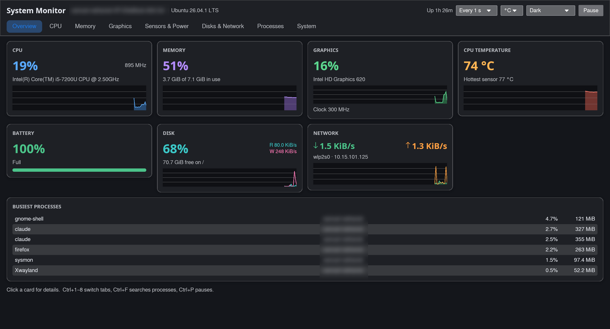
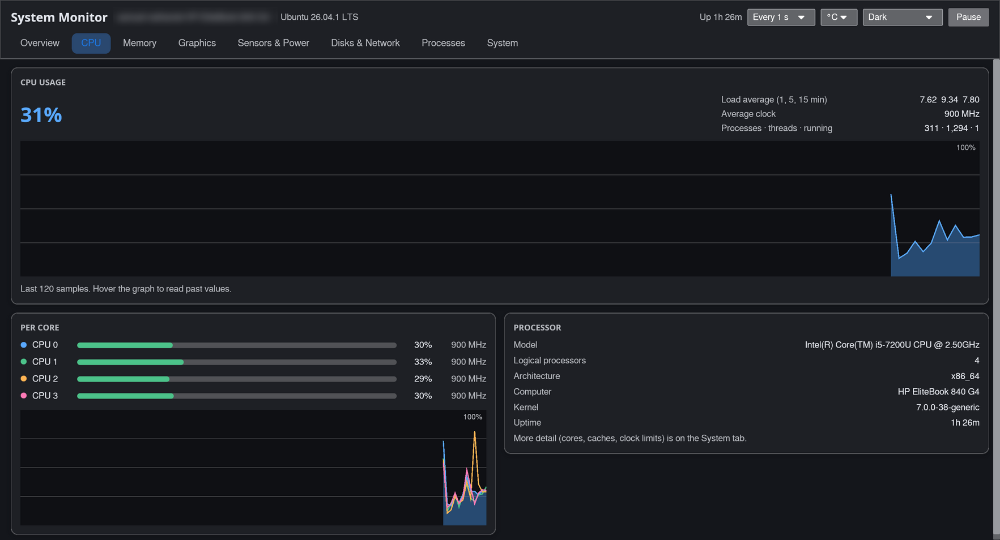
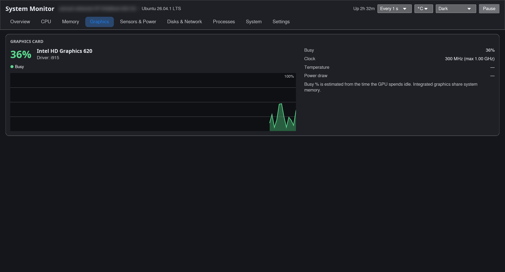
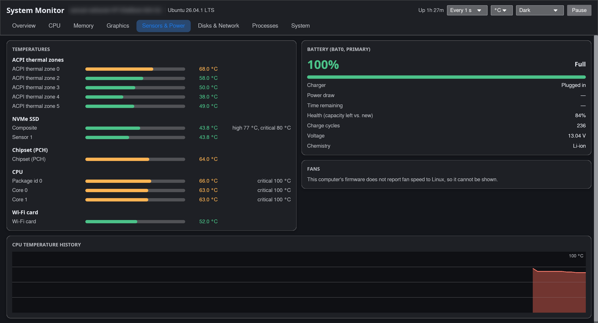
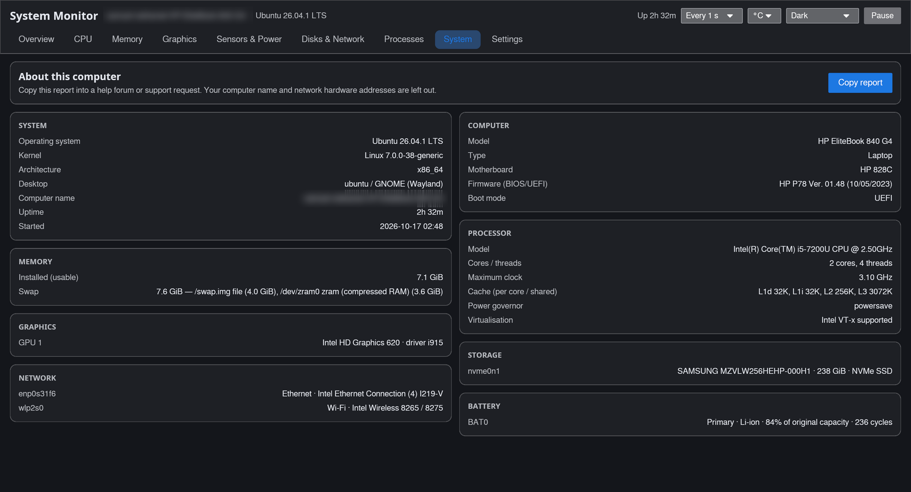
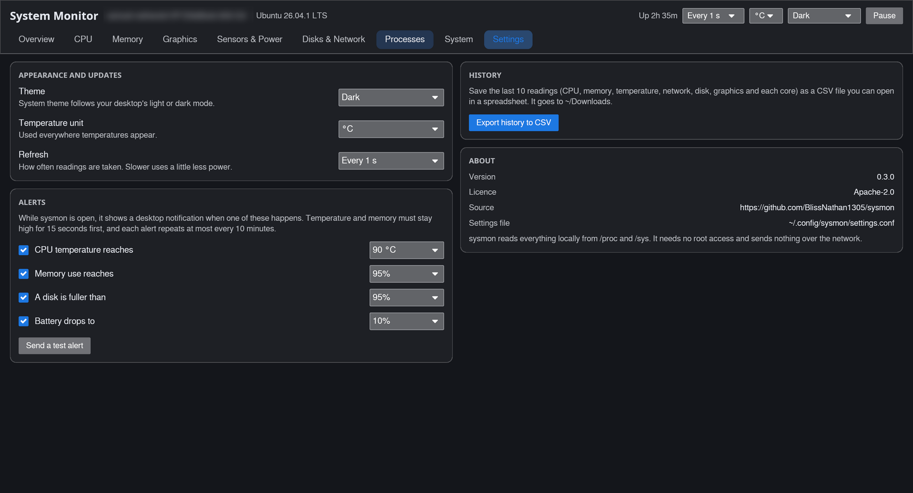

# sysmon

A live system monitor for Linux. One window shows what your computer is doing right now: processor and per-core load, memory and swap, graphics card, temperatures and fans, battery health, disks, network connections and every running process. It also has a hardware report you can copy into a help forum, optional desktop alerts, and a CSV export of recent readings.

It can also **watch a server**: a cloud machine on AWS, Azure, Google Cloud or DigitalOcean, a home server or a Raspberry Pi, over your normal SSH login, in the same window. On a machine you are logged into by SSH, `sysmon --tui` shows the same information in the terminal.

It reads everything straight from the kernel (`/proc` and `/sys`). It needs no root access, no background service and no internet connection, and it sends nothing anywhere.



## What it shows

| Tab | Contents |
| --- | --- |
| **Overview** | CPU, memory, graphics, temperature, battery, disk and network at a glance, plus the busiest processes. Click any card to open its tab. |
| **CPU** | Total use over the last 120 samples (hover the graph for past values), per-core use and clock speed, load average, process and thread counts. Machines with many cores get a compact grid. |
| **Memory** | Memory and swap history, a bar split into in-use, reclaimable cache and free, and a full breakdown. |
| **Graphics** | Busy %, clock speed, video memory, temperature, power and fan for each GPU (see [Graphics support](#graphics-support)). Hidden when the computer has no GPU driver. |
| **Sensors & Power** | Every temperature sensor, grouped (CPU, SSD, chipset, Wi-Fi, motherboard…) and coloured by how close it is to its limit. Fans, all batteries (charge, rate, time left, health, cycles, voltage) and wireless mouse or keyboard batteries. |
| **Disks & Network** | Disk read/write speed, space used on every drive (including ZFS and btrfs), download/upload speed, and each connection's addresses, Wi-Fi signal and data used. VPN, Docker and VM interfaces can be shown with a switch. |
| **Processes** | Sortable, searchable list with an "only my processes" filter and optional kernel threads. Click a row for details: parent, running time, memory, priority and the full command line. It is view-only: nothing can be ended or killed from here. |
| **System** | Operating system, desktop, computer model, firmware, processor (cores, caches, clock limits), memory, graphics, drives, network cards and batteries. **Copy report** puts it on the clipboard as plain text, leaving out your computer name. |
| **Settings** | Theme, temperature unit and refresh rate; desktop alerts with adjustable limits; CSV export; where settings are stored. |

Other conveniences:

- Light, dark, or **follows your desktop's theme** (GNOME, KDE, Xfce, Cinnamon, MATE and others).
- Temperatures in °C or °F.
- Refresh every 0.5, 1, 2 or 5 seconds, and a pause button.
- **Desktop alerts** while it is open: CPU too hot, memory or a disk almost full, battery low. Each can be switched off or given a different limit in Settings. Short spikes are ignored, and each alert repeats at most every 10 minutes.
- **Export history** (Ctrl+E): the last 120 readings of CPU, memory, temperature, network, disk, graphics and every core, as a CSV file in your Downloads folder.
- Remembers its window size.
- Works on X11 and Wayland, on laptops, desktops and virtual machines. If there is no usable GPU driver it draws the window in software instead. Builds are provided for x86-64 and ARM64 (Raspberry Pi 4 and 5 and similar).

| CPU | Graphics |
| --- | --- |
|  |  |
| **Sensors & Power** | **System report** |
|  |  |
| **Settings** | |
|  | |

## Install

### From a release (no Rust needed)

Download the file for your system from the [Releases page](https://github.com/BlissNathan1305/sysmon/releases):

- **Ubuntu, Debian, Linux Mint, Pop!_OS:** `sysmon_<version>-1_amd64.deb` (or `_arm64.deb`), then
  ```sh
  sudo apt install ./sysmon_*.deb
  ```
- **Fedora, openSUSE, RHEL and similar:** `sysmon-<version>-1.x86_64.rpm` (or `.aarch64.rpm`), then
  ```sh
  sudo dnf install ./sysmon-*.rpm      # or: sudo zypper install ./sysmon-*.rpm
  ```
- **Arch, Manjaro, EndeavourOS:** from the AUR, with an AUR helper such as `yay`:
  ```sh
  yay -S sysmon-bin     # ready-made, or `yay -S sysmon` to build from source
  ```
- **Any other distribution (Void, Gentoo, Slackware…):** `sysmon-<version>-x86_64-linux.tar.gz` (or `-aarch64-`), then
  ```sh
  tar xf sysmon-*-linux.tar.gz
  cd sysmon-*-linux
  ./install.sh              # just for you, in ~/.local (no sudo)
  sudo ./install.sh --system  # or for everyone, in /usr/local
  ```

Release builds need glibc 2.35 or newer, which covers most distributions released since 2022. On anything older, build from source. The `.deb` and `.rpm` pull in the few display libraries the window needs; with the tarball on a minimal system, see [Troubleshooting](#troubleshooting).

Then open **System Monitor (sysmon)** from your app menu, or run `sysmon` in a terminal.

### From source

You need Rust 1.87 or newer ([rustup.rs](https://rustup.rs)). No other development packages are required.

```sh
git clone https://github.com/BlissNathan1305/sysmon.git
cd sysmon
./install.sh
```

`install.sh` builds the program and installs it with its launcher and icon. Pass `--system` (with `sudo`) to install to `/usr/local` instead of `~/.local`.

### Uninstall

```sh
./install.sh --uninstall           # or: sudo ./install.sh --uninstall --system
sudo apt remove sysmon             # if installed from the .deb
sudo dnf remove sysmon             # if installed from the .rpm
```

Your settings stay in `~/.config/sysmon/`; delete that folder to remove them too.

## Watching a server (remote mode)

Pick **Add a server…** in the machine menu at the top right (or open **Settings → Servers**) and enter:

- **Address**: what you would type after `ssh`, such as `ubuntu@203.0.113.10`, `ec2-user@ec2-…amazonaws.com`, `root@my-droplet` or a `Host` name from `~/.ssh/config`.
- **Key file** (optional): for example the `.pem` file AWS gave you. Leave it empty to use your usual SSH keys or agent.
- **Port** (optional), if SSH is not on port 22.

sysmon then runs `ssh <server> sysmon --agent` and shows the server in every tab. Nothing new is opened on the server: no port, no service, no root access. It stops when you switch back to **This computer** or close the window.

If sysmon is not on the server yet, press **Install on server**. It downloads the matching release into `~/.local/bin` on the server (with `curl` or `wget`), or, if the server cannot download it, copies this computer's sysmon over SSH when both have the same kind of processor. You can also install it there yourself with any of the methods above; the window libraries are not needed for this.

Things to know:

- It uses key-based SSH logins only; there is no password prompt. Unknown servers are trusted on first connection (like answering "yes" to ssh's question); a server whose identity later changes is refused.
- Readings are sent compressed, about 10–15 KB per update, mostly the process list.
- On virtual machines there are no temperature, fan or battery sensors, so those panels are empty. GPU instances (for example AWS g4/g5 or Azure NC with NVIDIA cards) show their graphics card through `nvidia-smi`.
- Alerts work for the server you are watching, with its name in the notification.

## Terminal mode

```sh
sysmon --tui              # or: sysmon --tui --interval 2000
```

The same readings in the terminal, for SSH sessions and machines without a desktop: Overview, Processes, Disks & Network, Sensors & Power and System tabs. Keys: `1`–`5` or Tab to switch tabs, `/` to search processes, `s` to change the sort, `Enter` for process details, `k` for kernel threads, `o` for only your processes, `p` to pause, `+`/`-` for the refresh rate, `?` for help and `q` to quit. It reads the machine it runs on, needs no display libraries, and is view-only like the window.

## Graphics support

| GPU | What is shown |
| --- | --- |
| **AMD** (amdgpu driver) | Busy %, video memory, temperature, power, fan, clock. Everything, without extra software. |
| **NVIDIA** (proprietary driver) | Everything, read through `nvidia-smi`, which comes with the driver (on some distributions it is in a separate `nvidia-utils` package). |
| **NVIDIA** (nouveau driver) | Name and temperature. Nouveau does not report usage. |
| **Intel** (i915 and xe drivers) | Busy %, estimated from the time the GPU spends idle, plus the clock speed. The exact per-engine figures need root, so for those use `intel_gpu_top`. |
| **Others** (Raspberry Pi, virtual machines) | Name, and temperature where the driver has a sensor. |

GPU names come from the `pci.ids` database (the `hwdata` or `pciutils` package, installed on nearly every system).

## Notes and limitations

- **Fan speed** appears only if the computer's firmware reports it to Linux. Many laptops do not; on desktops, installing `lm-sensors` and running `sudo sensors-detect` can make motherboard fans and temperatures visible.
- **CPU %** for a process is a share of the whole processor (all cores together = 100%), so it matches the overall CPU figure.
- **Memory** for a process is its resident memory (RSS), the RAM it is actually using.
- Network totals count physical network cards only, so traffic through a VPN is not counted twice.
- Alerts only work while sysmon is open, since it has no background service. Notifications go through `notify-send` (libnotify) or, without it, straight to the desktop's notification service. They are also shown in a strip at the top of the window.

## Troubleshooting

**The window does not open and sysmon prints "could not open a window".** The display libraries are missing (this happens on minimal installs and in containers). Install them:

```sh
sudo apt install libxkbcommon-x11-0 libxcursor1 libxrandr2 libxi6 libwayland-client0     # Debian, Ubuntu
sudo dnf install libxkbcommon-x11 libXcursor libXrandr libXi libwayland-client           # Fedora
sudo pacman -S libxkbcommon-x11 libxcursor libxrandr libxi wayland                       # Arch
```

**It prints "the window is drawn in software instead".** No usable GPU driver was found (common in virtual machines). Everything still works; installing Mesa (`libgl1-mesa-dri` / `mesa-dri-drivers` / `mesa`) gives smoother drawing. To always use software drawing, start it with `ICED_BACKEND=tiny-skia sysmon`.

**It prints "could not find any font".** The system has no fonts installed (only seen on bare containers). Install one: `fonts-dejavu-core` (Debian, Ubuntu), `dejavu-sans-fonts` (Fedora), `dejavu-fonts` (openSUSE) or `ttf-dejavu` (Arch).

**No temperatures or fans.** See the note on fan speed above. Virtual machines have no sensors.

## Keyboard shortcuts

| Keys | Action |
| --- | --- |
| Ctrl+1 … Ctrl+9 | Switch tabs |
| Ctrl+F | Search processes |
| Ctrl+P | Pause or resume updates |
| Ctrl+E | Export the recent history to CSV |

Command line: `sysmon --tui` for terminal mode, `sysmon --agent` (used by remote mode), `sysmon --help` and `sysmon --version`.
| Esc | Close the process details |
| Ctrl+Q | Quit |

## Settings

Everything on the Settings tab, plus the last tab, the window size and the display switches, is saved to `$XDG_CONFIG_HOME/sysmon/settings.conf` (normally `~/.config/sysmon/settings.conf`) whenever you change it. It is a plain `key=value` file, for example `alert_temp=on:90` or `alert_battery=off:10`.

## Building and contributing

```sh
cargo build --release       # program at target/release/sysmon
cargo test                  # unit tests
cargo clippy --all-targets -- -D warnings
cargo fmt
```

The code is small and has two dependencies ([iced](https://iced.rs) for the window, `libc` for a few system calls):

| File | Role |
| --- | --- |
| `src/stats.rs` | Reads CPU, memory, sensors, power, disks, network and processes |
| `src/gpu.rs` | Graphics card readings per driver |
| `src/report.rs` | The System tab's hardware report |
| `src/pci.rs` | PCI device names from `pci.ids` |
| `src/alerts.rs` | Alert rules and desktop notifications |
| `src/history.rs` | Recent readings for the graphs and the CSV export |
| `src/remote.rs` | Remote mode: the agent, the SSH connection and installing on a server |
| `src/tui.rs` | Terminal mode |
| `src/main.rs` | Window, settings and update loop |
| `src/view.rs` | Everything drawn on screen |
| `src/graph.rs`, `src/style.rs` | Line graphs and colours |

`cargo test -- --ignored live` runs an end-to-end remote-mode test against a real SSH server (set `SYSMON_TEST_SSH`, and optionally `SYSMON_TEST_PORT` and `SYSMON_TEST_KEY`); it was developed against an Ubuntu container running sshd.

The tests include fake `/sys` trees for hardware that is hard to have on one desk: AMD and Intel graphics, AMD processors with motherboard fans, ARM boards, laptops with two batteries and wireless mice, and desktops without a battery.

Pushing a tag such as `v0.3.0` makes GitHub Actions build the `.tar.gz`, `.deb` and `.rpm` for x86-64 and ARM64 and attach them to a release. The AUR recipes are in `packaging/aur/`.

## Licence

Licensed under the [Apache License, Version 2.0](LICENSE).
